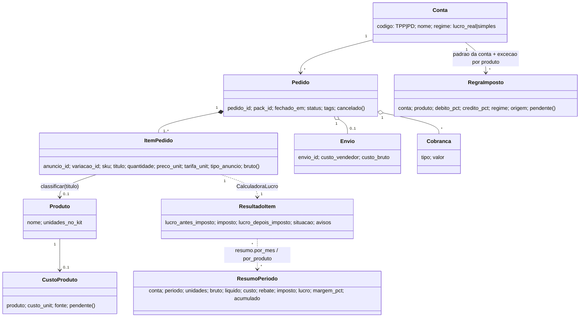

# Arquitetura do painel de vendas (TPP + PD)
Esqueleto de 11/11/2026 (reorganizado no mesmo dia: documentação fora da pasta do código; roda em qualquer PC e no Docker).
Requisitos e fases: `PLANO-PAINEL-ML.md`. Estado de cada peça e como rodar: `LEIA-ME.md` (os três nesta pasta `painel\docs`).

## 1. Camadas (cada uma só conhece a de baixo)
Caminhos relativos à raiz do projeto; código do painel em `painel\`.
```
 [4] TELA (Streamlit)        painel\app.py, painel\paginas\*.py        Python 3.12 (Docker ou venv) + streamlit, pandas, plotly
        |  só chama o núcleo; nenhuma conta de negócio na tela
 [3] NÚCLEO (regras)         painel\nucleo\*.py                        só biblioteca padrão (+ openpyxl no Excel)
        |  calcula lucro, resume, exporta, confere, controla a atualização; configuração em painel\nucleo\caminhos.py
 [2] DADOS (repositórios)    painel\nucleo\repositorio.py              lê SQLite, CSV e JSON; não escreve
        |
 [1] COLETA (API, só GET)    analise\ml_pedidos.py (novo)              mesma regra do projeto: só Coleta.get
                             analise\ml_api_coletor.py                 (fase 1a)
        |
     pastas (cada uma por variável de ambiente; padrão = a do projeto):
       DADOS   (ML_DADOS_DIR)   coletas, monitor, vendas_api.db (pedidos, sem comprador)
       CONFIG  (ML_CONFIG_DIR)  ml_parametros.json, custos_produtos.csv
       TOKENS  (ML_API_DIR)     só na máquina que atualiza
```
**Por que assim**
- A regra de lucro fica num lugar só (núcleo), e ele **reaproveita** `ml_margem` (produto pelo título, kit, custo, rebate) e
  `ml_param` (imposto por conta e produto). O painel e os relatórios .md nunca divergem.
- O núcleo não depende do Streamlit: os testes rodam só com Python e openpyxl (`python -m unittest`), e a tela pode
  mudar (Streamlit, outra ferramenta) sem mexer na conta.
- A coleta é a única camada que fala com o ML, e só por `Coleta.get` (GET). O painel nunca chama a API direto: o botão
  "Atualizar" chama a coleta por meio do `Atualizador` (trava + intervalo).
- `vendas_api.db` é um banco **separado** de qualquer outro banco das análises: pedidos não somem numa reimportação.

## 2. Classes e relações (núcleo)

Serviços (sem estado de negócio):

| Classe / módulo | Responsabilidade | Depende de |
|---|---|---|
| `RepositorioPedidos` | lê `vendas_api.db` e devolve `Pedido` com itens, envio e cobranças | SQLite |
| `RepositorioParametros` | custo, rebate e `RegraImposto` por conta/produto | `ml_param`, `ml_margem.ler_custos` |
| `CalculadoraLucro` | `Pedido` → `ResultadoItem` (rateio do frete por valor, kit, crédito de imposto) | repositório de parâmetros, `ml_margem` |
| `resumo` | `ResultadoItem` → `ResumoPeriodo` por mês, acumulado, por produto | modelos |
| `exportar` | qualquer lista de linhas → CSV (`;`, utf-8-sig) e Excel com abas (Arial, autor) | `openpyxl` |
| `Atualizador` | uma atualização por vez (trava em arquivo) e intervalo mínimo; registra a execução | sistema de arquivos |
| `conferencia` | provas de que é "fiel": API × Excel do ML, unidades, sem comprador | repositórios, `ml_margem.vendas` |

## 3. Fórmulas (uma regra só)
Por item de pedido (valores em R$, `float` arredondado a 2 casas, como no resto do projeto):
- bruto = `preco_unit` × quantidade (`unit_price` já vem com desconto do vendedor);
- tarifa = `sale_fee` × quantidade; frete = custo do vendedor no envio, **rateado pelo bruto** entre os itens do pedido/pacote;
- **líquido** = bruto − tarifa − frete (a doc do ML: `unit_price × quantity − marketplace_fee − seller.cost`), conferido com a cobrança;
- custo = `ml_margem.custo_mercadoria(produto, título, custos, rebate=0)` × quantidade (kit e brinde já tratados lá);
- rebate = custo sem rebate − custo com rebate, pela mesma função (só produtos com `aplica_rebate=sim` em `custos_produtos.csv`;
  % do parâmetro `rebate`; com × sem);
- **lucro antes do imposto** = líquido − custo + rebate  (fórmula da tarefa original);
- imposto = bruto × débito % − custo da mercadoria × crédito % (crédito = 0 no Simples; `ml_param.imposto_pct/credito_pct`);
- **lucro depois do imposto** = lucro antes − imposto. Regra sem alíquota (PD hoje) → imposto 0 e aviso "imposto pendente".
- situação: `valida`, `cancelada`, `devolvida` (canceladas/devolvidas ficam fora dos totais e em lista separada).

## 4. Banco `vendas_api.db` (só a lista fechada; esquema em `analise\ml_pedidos.py`)
| Tabela | Chave | Colunas |
|---|---|---|
| `pedidos` | conta, pedido_id | pack_id, criado_em, fechado_em, status, tags, total, cupom, envio_id, coletado_em |
| `pedido_itens` | conta, pedido_id, seq | anuncio_id, variacao_id, sku, titulo, quantidade, preco_unit, tarifa_unit, tipo_anuncio |
| `envios` | conta, envio_id | pedido_id, custo_vendedor, custo_bruto |
| `cobrancas` | conta, pedido_id, tipo, seq | valor, descricao |
| `execucoes` | id | conta, tipo, inicio, fim, pedidos_novos, chamadas, erros |

**Privacidade por construção:** o coletor copia só as chaves desta lista (`filtrar_pedido`); comprador, apelido, destinatário,
endereço e telefone nunca entram, então não há o que vazar na tela nem no download. Os testes conferem que essas palavras não
aparecem no código do coletor nem do painel, e `conferencia.sem_comprador` confere as colunas do banco.

## 5. Decisões (registro)
| # | Decisão | Por quê | Alternativa descartada |
|---|---|---|---|
| D1 | Vendas pela API, lista fechada de campos | mais fácil de atualizar; decidido em 11/11 | Excel manual (continua só para antes de 12 meses) |
| D2 | Streamlit + núcleo em Python puro | mesmo código e mesma regra do projeto | Power BI/Looker (não leem a API do ML direto) |
| D3 | Python 3.12 em venv só para a tela | Streamlit/pandas sem pacote pronto para 3.14 aqui; o código do projeto compila em 3.12 (conferido 11/11) | atualizar tudo para 3.12 |
| D4 | Banco separado `vendas_api.db` | `historico.db` é recriado pela importação | tabela dentro do histórico |
| D5 | Botão com trava em arquivo + intervalo (parâmetro `painel.intervalo_atualizacao_min`) | token do ML de uso único; não repetir chamadas | atualizar a cada acesso |
| D6 | Imposto pelo bloco `imposto` já existente | mesma regra dos relatórios; TPP já preenchida | tabela própria do painel |
| D7 | Nenhum caminho de um PC: tudo por variável de ambiente com padrão relativo ao projeto (`caminhos.py`, `ml_param.DIR_*`) | projeto de 4 pessoas, em PCs diferentes | caminho fixo |
| D8 | Docker (imagem só com código; dados, parâmetros e tokens como volume) | igual em qualquer PC; nada da empresa dentro da imagem | instalar Python em cada PC (continua possível: `instalar.ps1`) |
| D9 | **Uma** máquina atualiza (tem os tokens; `PAINEL_PERMITE_ATUALIZAR=1`) | o refresh token do ML é de uso único: duas máquinas renovando derrubam o acesso uma da outra | cada PC com seus tokens |
| D10 | **Servidor único com acesso pela web** (decidido em 11/11) | todos veem o mesmo número na mesma hora; ninguém instala nada; token num lugar só | cada um rodar no próprio PC com pasta compartilhada |

## 6. Como várias pessoas usam
**Decidido (11/11): um servidor só, acesso pela web (navegador).** Os usuários abrem o endereço
do servidor; ninguém instala nada no próprio PC. Só o servidor roda o painel, guarda os tokens e tem o botão "Atualizar agora".

| Modo | Quem | Como | Tokens |
|---|---|---|---|
| **Servidor (adotado)** | uma máquina | `docker compose up -d` com `PAINEL_PERMITE_ATUALIZAR=1` e `PAINEL_EXPOR=0.0.0.0`; os usuários abrem `http://<endereço-do-servidor>:8501` | só nela |
| Desenvolvimento | quem desenvolve | sem Docker: `instalar.ps1` + `rodar.ps1` (pastas do projeto), só para testar mudanças | os próprios (não rodar ao mesmo tempo que o servidor atualiza) |
| Só leitura local (não adotado) | — | possível pela portabilidade (`ML_DADOS_HOST` numa pasta compartilhada), mas não é o plano | nenhum |

**Ainda a decidir:** qual máquina é o servidor; se o acesso é só pela rede da empresa ou também de fora, e com
qual login (ex.: Cloudflare Tunnel + Access, grátis até 50 usuários). Fase 4.
A portabilidade serve para o servidor ficar em qualquer máquina e trocar de máquina sem mudar código.
**Risco aberto (não resolvido no esqueleto):** se um agendamento de coleta/monitor em outro PC e um servidor Docker
usarem os mesmos tokens ao mesmo tempo, a renovação pode colidir. Antes de ligar o botão (fase 2): ou só o servidor coleta, ou
`ml_auth` ganha uma trava entre processos na renovação.

## 7. Estrutura de pastas
Raiz do repositório (`Painel-Mercado-Livre---Gestor-de-Vendas-ML`):
```
README.md  CLAUDE.md                visão geral e regras (CLAUDE.md = instruções para o Claude Code)
.gitignore  .gitattributes  .editorconfig   segredos e dados da empresa fora do git; fim de linha e codificação
.github\workflows\testes.yml        testes a cada push (Python 3.12)
Dockerfile  .dockerignore  compose.yaml  .env.exemplo  requirements.txt  instalar.ps1  rodar.ps1   rodar o painel (com e sem Docker)
docs\                               só documentação: ARQUITETURA.md  LEIA-ME.md  PLANO-PAINEL-ML.md
painel\                             pacote Python do painel (vai para a imagem Docker)
  app.py                            entrada (navegação entre as páginas)
  paginas\                          visao_geral.py  vendas_e_lucro.py  downloads.py
  nucleo\                           caminhos.py  modelos.py  repositorio.py  calculo.py  resumo.py  exportar.py  atualizar.py  conferencia.py
testes\                             test_modelos.py  test_privacidade.py  test_atualizar.py  test_configuracao.py  test_pacote.py
analise\ml_pedidos.py               coletor de pedidos (camada 1)
analise\ml_param.py, ml_margem.py   parâmetros e regra de custo
analise\ml_parametros.json, custos_produtos.csv   dados da empresa: fora do git, recebidos pelo canal interno
```
Da pasta `analise\` só entram na imagem Docker os módulos que o painel importa: hoje `ml_param`, `ml_margem`
e `ml_pedidos` (lista no `Dockerfile` e no `.dockerignore`). Na fase 1a, quando `ml_pedidos` passar a usar `ml_api_coletor` e `ml_auth`, o `test_pacote.py` falha até
os dois entrarem nas duas listas.
```
<DADOS>\vendas_api.db               criado pelo coletor (fora de qualquer repositório e da imagem)
```
